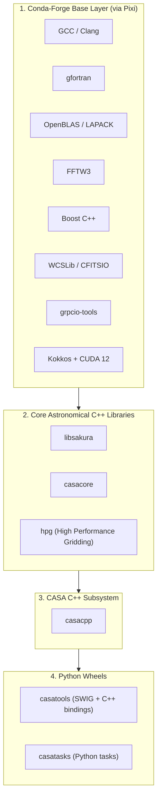

# Build Design & Toolchain

*Originally designed by [@schiebel](https://github.com/schiebel) in [schiebel/casa6-dev](https://github.com/schiebel/casa6-dev).*

The build stacks five layers together:



---

## Pixi Features & Solve Groups

Instead of maintaining one huge environment, [`pixi.toml`](https://github.com/r-xue/casa6-dev/blob/main/pixi.toml) splits dependencies into smaller **features** you can mix and match:

1. **Python Versions**:
    - `py311`, `py312` (default), `py313`, and `py314`.
    - Each Python feature sets its own compatible Cython and NumPy versions.
2. **Platforms**:
    - `linux`: `gcc`, `gfortran`, `libgomp` (`linux-64` and `linux-aarch64`).
    - `arm-mac`: Apple Silicon `clang`, `gfortran`, `llvm-openmp`.
    - `intel-mac`: Intel `clang` (currently 22.1.8 in `pixi.lock`), `gfortran 13`, `llvm-openmp`, plus a linker wrapper for Xcode 16.
3. **Optional Features**:
    - `gpu`: `kokkos` (CUDA build), `cuda-nvcc`, `libcufft-dev`. Sets `CASA_ENABLE_GPU="1"` and `CASA_GPU_ARCH="sm_80"`.
    - `mpi`: `openmpi`, `mpi4py`. Sets `MPI_ROOT="$CONDA_PREFIX"`.
    - `dev`: `ipython`, `jupyter`.

### Solve Groups
Pixi **solve groups** ensure that interactive environments (which include dev tools like IPython and Jupyter) and headless build environments resolve to the exact same package versions. For example, `linux-dev` and `build-linux` both belong to `linux-312`.

---

## Compiler Caching (ccache)

Compiling `casacore`, `casacpp`, and `casatools` takes time due to heavy C++ templates. We enable **ccache** by default in all environments:

- `CMAKE_C_COMPILER_LAUNCHER = "ccache"`
- `CMAKE_CXX_COMPILER_LAUNCHER = "ccache"`
- Cache folder: `$PIXI_PROJECT_ROOT/tmp/ccache` (2GB max, compressed).
- Sloppiness settings (`include_file_ctime,include_file_mtime,time_macros`) ensure cache hits across branch switches and rebuilds.

Useful cache commands:
```bash
pixi run ccache-stats   # View cache hits and size
pixi run ccache-clear   # Wipe the cache
```
