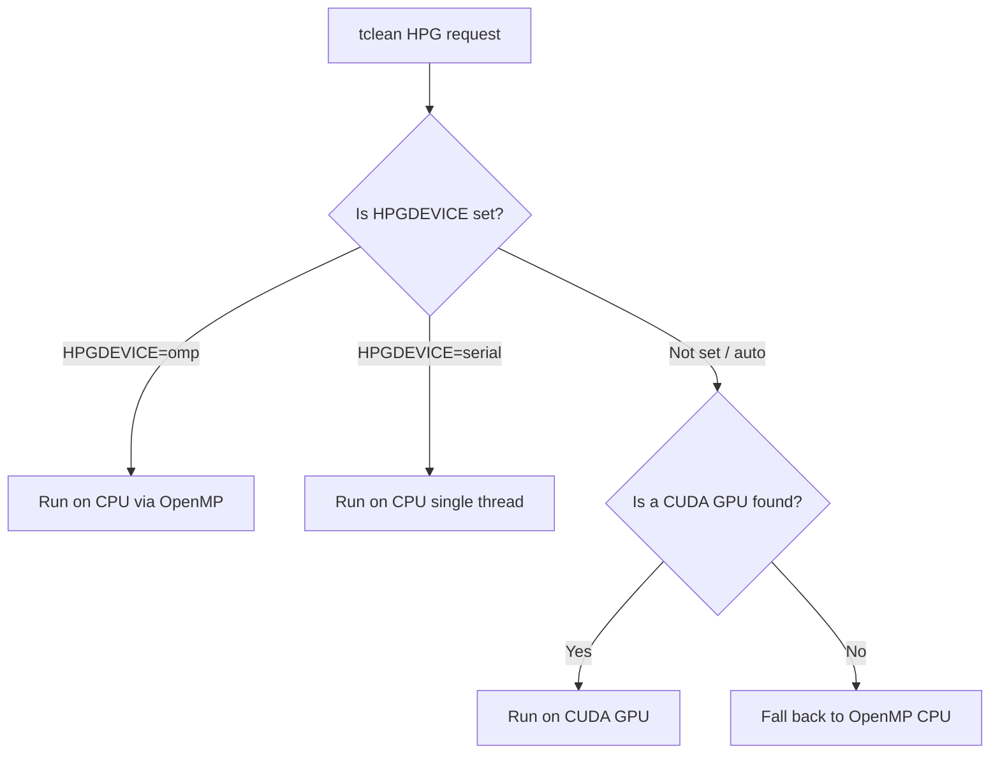

# GPU & HPG Gridding

[High Performance Gridding (HPG)](https://gitlab.nrao.edu/mpokorny/hpg) is an NRAO gridding library that uses Kokkos to run imaging algorithms on NVIDIA GPUs (CUDA) or multicore CPUs (OpenMP).

This project lets you compile CASA 6 with HPG GPU support while still allowing the same code to run smoothly on CPU-only machines.

---

## Building with GPU Support

GPU builds require the `linux-64-cuda` platform flag so Pixi installs the CUDA 12 variant of Kokkos, the NVCC compiler, and CUFFT headers:

```bash
pixi run --platform linux-64-cuda -e linux-gpu build-all
```

### Choosing your GPU Architecture (`CASA_GPU_ARCH`)

By default, builds target `sm_80` (NVIDIA Ampere / A100). If you want to optimize for your specific card, set `CASA_GPU_ARCH`:

| GPU Model / Generation | Architecture Flag |
| :--- | :--- |
| **A100 / Ampere** (Default) | `sm_80` |
| **RTX 30-series / A4000 / A6000** | `sm_86` |
| **RTX 40-series / L40 / Ada Lovelace** | `sm_89` |
| **H100 / Hopper** | `sm_90` |
| **V100 / Volta** | `sm_70` |

Example:
```bash
CASA_GPU_ARCH="sm_89" pixi run --platform linux-64-cuda -e linux-gpu build-all
```

---

## Choosing Devices at Runtime (`HPGDEVICE`)

When `casatools` is compiled with GPU support, it looks for available CUDA devices at startup.

You can override this and force CPU multi-threading or single-core execution at any time by setting the **`HPGDEVICE`** environment variable:



### Examples

=== "In your terminal"
    ```bash
    # Force 16-thread CPU gridding
    export HPGDEVICE=omp
    export OMP_NUM_THREADS=16
    pixi run --platform linux-64-cuda -e linux-gpu python my_script.py
    ```

=== "One-liner"
    ```bash
    HPGDEVICE=omp OMP_NUM_THREADS=8 pixi run --platform linux-64-cuda -e linux-gpu python my_script.py
    ```

=== "In Python"
    ```python
    import os
    os.environ["HPGDEVICE"] = "omp"
    os.environ["OMP_NUM_THREADS"] = "8"

    # Run tclean with the HPG gridder
    tclean(..., gridder='awphpg')
    ```

---

## Why GPU Wheels Still Work on CPU-Only Machines

Normally, if a Python wheel is linked against CUDA, importing it on a machine without NVIDIA drivers immediately crashes with:
```
ImportError: libcuda.so.1: cannot open shared object file: No such file or directory
```

We handle this so users don't need two separate wheels:
1. **Bundled stub**: We package a small dummy `libcuda.so` stub inside the wheel.
2. **Automatic preload**: When `import casatools` runs, it checks whether the system has a real `libcuda.so.1`. If not, it preloads the bundled stub.
3. **CPU fallback**: The C++ code detects that no working GPU device is accessible and automatically routes gridding through OpenMP on the CPU.
